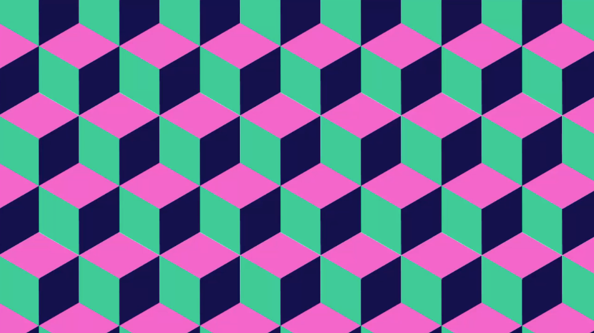
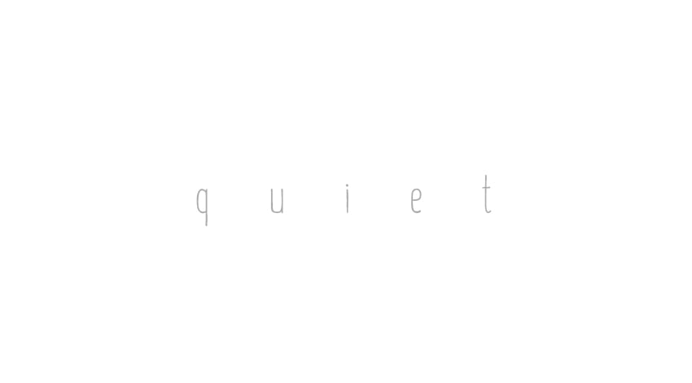
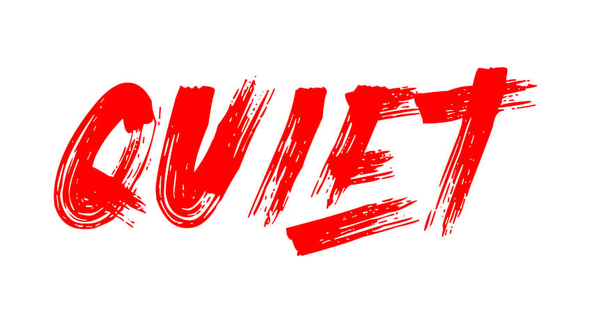
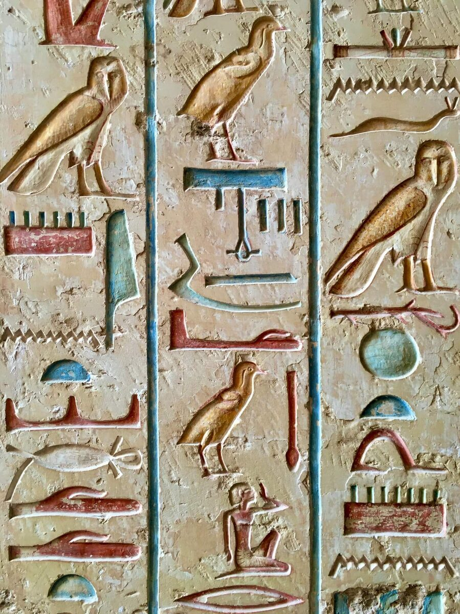
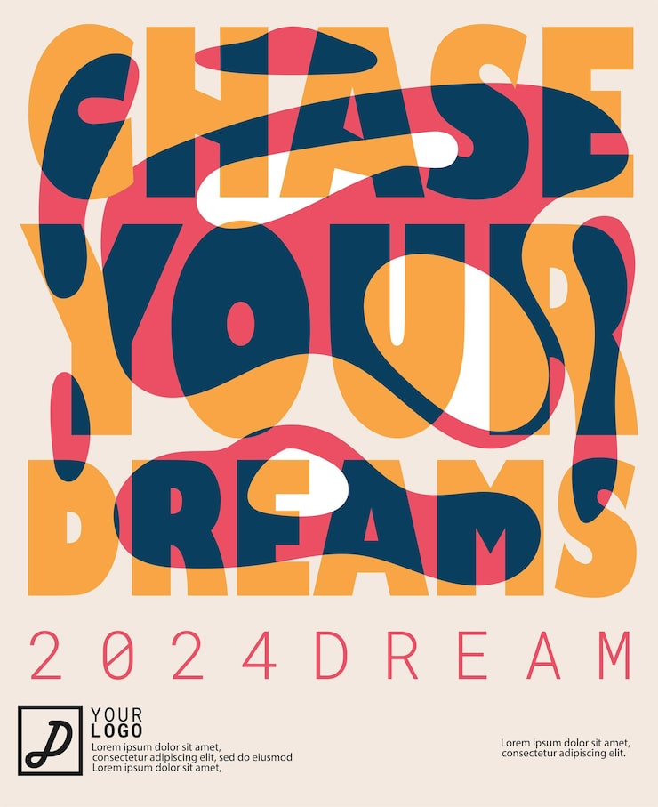
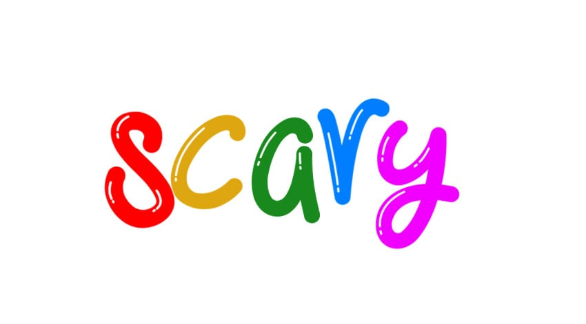
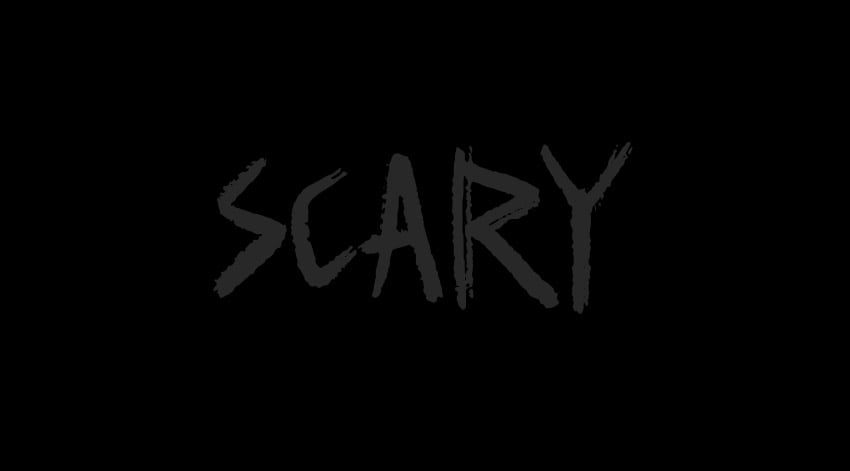
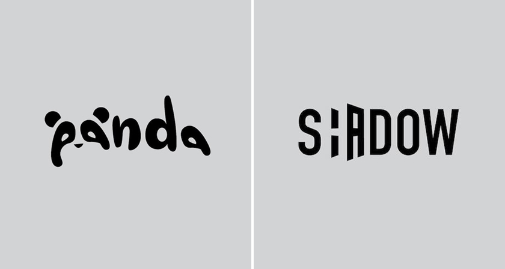
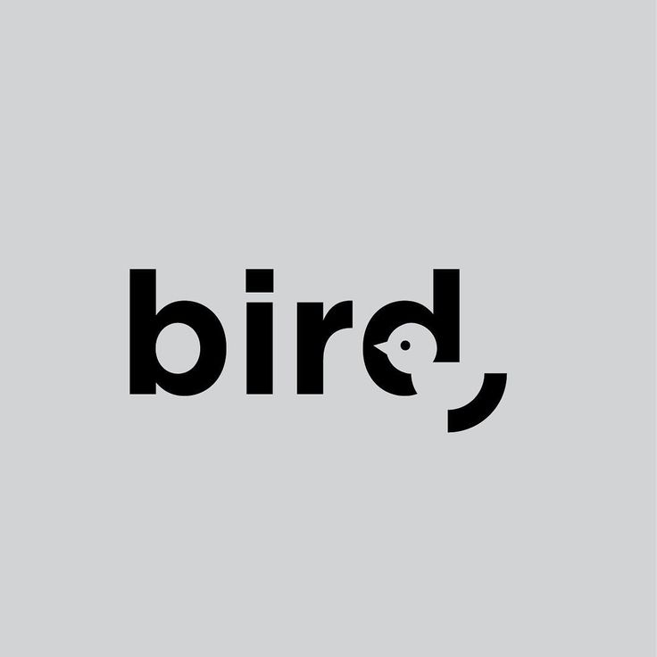

<!-- .slide: class="bleed dark" data-background-color="#111111" -->

  

  
Design1 · P1 · Week 6 · GLR Media Creative

  <h1 class="title title--xl" style="color:#fff">Typografie</h1>
  
Elk lettertype vertelt een verhaal. Vandaag leer je het juiste kiezen.

  
Design1 · Typografie01

Note: Welkom. Vorige lessen ging het over vorm en kleur; vandaag is typografie aan de beurt, het derde onderdeel van de P1-doelen en van de toets. Rode draad van de les (ABT): je kiest elke dag uit duizenden lettertypes EN ze zijn allemaal leesbaar, MAAR elk font vertelt een ander verhaal, DAAROM kies je typografie bewust op sfeer en onderbouw je die keuze. Laat deze slide staan terwijl studenten binnenkomen.

---

Even kijken · 30 seconden

## Hetzelfde woord. Welke van de twee fluistert?

  <figure>
    
    
Aquiet

  </figure>
  <figure>
    
    
BQUIET

  </figure>

Design1 · Typografie02

Note: Gagné 1 — aandacht trekken. Vraag niets uit te leggen; laat de klas alleen met de vingers kiezen: 1 = A, 2 = B. Bijna iedereen kiest A. Vraag één student: waarom? Je hoeft het antwoord nog niet uit te diepen; vat samen: "jullie lazen allemaal hetzelfde woord, maar hoorden iets anders. Dat doet typografie. Aan het eind van de les kun je uitleggen waarom." We komen op dit voorbeeld terug bij Sfeer uitbeelden.

---

Afspraken

## Zo werken we vandaag

  
01<h3>Geen telefoons</h3>
Je laptop is je gereedschap; je telefoon blijft in je tas.

  
02<h3>Niet eten of drinken</h3>
Alleen drinken uit een afgesloten fles.

  
03<h3>Even melden</h3>
Laat het weten als je het lokaal verlaat.

Design1 · Typografie03

Note: Korte herhaling van de vaste afspraken. Geen discussie, door naar de planning.

---

Planning

## Eerst kijken en oefenen, dan zelf ontwerpen

  
5 min
<h3>Leer- en lesdoelen</h3>

  
10 min
<h3>Uitleg: soorten letters, hiërarchie, interlinie, kerning</h3>

  
10 min
<h3>Oefening: kerning en vorm</h3>

  
5 min
<h3>Sfeer uitbeelden + check</h3>

  
30 min
<h3>Opdracht 1: drie situaties, drie lettertypes</h3>

  
rest
<h3>Opdracht 2: jouw naam in letters</h3>

  
10 min
<h3>Afsluiting + vooruitblik: de toets voor Museum de Pixel</h3>

Design1 · Typografie04

Note: Loop de planning kort door. Benadruk dat je aan het eind van de les vooruitkijkt naar de toets: volgende les begint het onderzoek voor het logo van Museum de Pixel, en typografie is daar een van de drie onderdelen. Wat je vandaag in opdracht 1 en 2 doet, is daar oefening voor. Houd de laatste 10 minuten vrij voor afsluiting en vooruitblik.

---

Leerdoelen P1 · Hierop word je in de toets beoordeeld

## Vandaag werk je aan het derde P1-doel: typografie

  
01
<h3>Vorm</h3>
Je kiest en gebruikt basisvormen om de uitstraling, betekenis en duidelijkheid van een ontwerp te versterken.

  
02
<h3>Kleur</h3>
Je kiest kleuren die passen bij een gewenst gevoel of een bepaalde sfeer en legt uit waarom.

  
03
<h3>Typografie · vandaag</h3>
Je kiest typografie die past bij een gewenste emotie of sfeer en legt uit waarom.

  
04
<h3>Ideeën &amp; keuze</h3>
Je bedenkt verschillende ideeën, onderzoekt mogelijkheden en maakt een onderbouwde keuze.

Design1 · Typografie05

Note: Gagné 2 — doelen. Dit zijn de vier doelen van P1; precies deze vier staan straks als criteria in de rubric van de toets. Vorm en kleur hebben we gehad, vandaag typografie. Doel 4 (ideeën en keuze) loopt overal doorheen: steeds meerdere opties bekijken en daarna onderbouwd kiezen.

---

Lesdoelen typografie

## Aan het einde van deze les kun je …

1. verschillende soorten typografie **herkennen** en de kenmerken **benoemen**;
2. **uitleggen** welke invloed typografie heeft op de uitstraling, betekenis en sfeer van een ontwerp;
3. typografie **kiezen** die past bij een gewenst gevoel, emotie of sfeer, en die keuze **onderbouwen**.

Design1 · Typografie06

Note: Gagné 2. Drie doelen, van herkennen (onthouden/begrijpen) naar kiezen en onderbouwen (toepassen/evalueren). Het laatste doel toets je straks zelf in opdracht 1 en 2: niet alleen een font kiezen, maar ook in één of twee zinnen uitleggen waarom.

---

<!-- .slide: class="dark" data-background-color="#111111" -->

Voorkennis · Denk – deel · 1 minuut

Welk merk herken je aan alleen de letters van het logo, zonder plaatje?

Noem er één aan je buur. Wat zie je aan die letters dat bij het merk past?

Design1 · Typografie07

Note: Gagné 3 — voorkennis activeren. Een minuut overleggen met je buur, daarna 3 à 4 voorbeelden ophalen. Vaak genoemd: Coca-Cola (sierlijk, klassiek schrift), Google (rond, vriendelijk, sans serif), Disney (handgeschreven, sprookjesachtig), Netflix (strak, hoog, filmisch). Schrijf de woorden die studenten gebruiken (sierlijk, strak, speels …) op het bord: dat zijn sfeerwoorden, en die heb je straks nodig.

---

Video · Kijk en let op

## Typografie stuurt hoe je een boodschap leest en voelt

  

    <iframe data-src="https://www.youtube-nocookie.com/embed/sByzHoiYFX0" title="Video: uitleg over typografie (Engels, zet ondertiteling op Nederlands)" allow="autoplay; encrypted-media; picture-in-picture" allowfullscreen></iframe>
  

  

    

      Kijkvraag
      
Noem <strong>twee manieren</strong> waarop typografie de lezer stuurt.

    

    
Ondertiteling: CC → Nederlands. Werkt de video niet? <a href="https://www.youtube.com/watch?v=sByzHoiYFX0">Open op YouTube</a>

  

Design1 · Typografie08

Note: Samenvattend filmpje over typografie. Zet CC op "Dutch" voor Nederlandse ondertiteling. Geef de kijkvraag vóór je start. Na afloop 2 à 3 antwoorden ophalen. Kern: bij typografie gaat het niet alleen om een lettertype dat er mooi uitziet en in je ontwerp past, maar om de juiste snaar raken: een boodschap overbrengen, een emotie versterken of sfeer creëren. Typografie verandert hoe mensen een tekst lezen en kan een actie benadrukken, bijvoorbeeld door verschillende lettertypes of groottes voor koppen en tussenkoppen.

---

Herkomst · Van beeld naar letter

## Schrift begon als beeld, en letters werken nog steeds als beeld

  <figure>
    
    <figcaption><strong>± 3000 v.Chr.</strong> · Hiërogliefen: tekens zijn plaatjes (pictografisch).</figcaption>
  </figure>
  <figure class="fragment">
    
    <figcaption><strong>Nu</strong> · Typografische poster: de vorm van de letters ís het beeld.</figcaption>
  </figure>

Design1 · Typografie09

Note: Typografie heeft een rijke geschiedenis die teruggaat tot de oudheid, tot de oorsprong van het schrift. De oudste bekende vormen zijn meer dan 5.000 jaar oud, zoals spijkerschrift en hiërogliefen. Die waren pictografisch: er werden vooral afbeeldingen gebruikt om iets uit te drukken. Klik dan de poster erbij: ook vandaag zijn letters beeld. Hier bepaalt de vorm van de letters de energie van de boodschap. Vraag: welk gevoel geeft deze poster? (Speels, energiek, dromerig.)

---

Soorten letters · Herkennen

## Een schreef maakt het verschil tussen serif en sans serif

  <figure class="col" style="flex:1 1 58%">
    
  </figure>
  

    

      
Links · sans serif<h3>Zonder schreef</h3>
Strak, modern, helder. Goed leesbaar op schermen.

      
Rechts · serif<h3>Met schreef (voetjes)</h3>
Klassiek, betrouwbaar, deftig. Veel in kranten en boeken.

    

  

Design1 · Typografie10

Note: Vraag eerst: wat is het verschil tussen deze twee letters? Laat studenten het zelf zien (het voetje bij de rode cirkel). Klik dan de twee kaarten. "Sans" is Frans voor "zonder": sans serif = zonder schreef. Benoem dat het verschil ook een gevoel oproept: serif voelt klassiek en betrouwbaar, sans serif modern en strak. Er zijn meer families (script/handschrift, display/decoratief, monospace), maar serif en sans serif zijn de basis.

---

Waar let je op? · 1. Hiërarchie

## Hiërarchie bepaalt wat je als eerste, tweede en derde leest

  

    Zonder hiërarchie
    
Expositie

    
Museum de Pixel: 40 jaar games

    
Vrijdagavond · gratis entree · vanaf 19.00 uur in de grote zaal

  

  

    Met hiërarchie
    
1Expositie

    
2Museum de Pixel: 40 jaar games

    
3Vrijdagavond · gratis entree · vanaf 19.00 uur in de grote zaal

  

Design1 · Typografie11

Note: Hiërarchie draait om de functie van typografie en de boodschap. Deel je tekst op van belangrijk naar minder belangrijk: wat moet als eerste gelezen worden, wat daarna? Links: alles even groot, je oog weet niet waar het moet beginnen. Klik: rechts dezelfde tekst, nu met verschil in grootte en gewicht. Klik de nummers 1-2-3: zo leest je oog. Middelen voor hiërarchie: grootte, dikte, kleur, ruimte en positie. (Het voorbeeld gaat bewust over Museum de Pixel; daar kom je straks op terug.)

---

Waar let je op? · 2. Interlinie

## Interlinie bepaalt of een tekst ademt of benauwt

  

    Te krappe interlinie
    
Typografie is meer dan een lettertype kiezen. Met de ruimte tussen de regels bepaal je hoe rustig of hoe druk een tekst aanvoelt, en hoe makkelijk je hem leest.

  

  

    Goede interlinie
    
Typografie is meer dan een lettertype kiezen. Met de ruimte tussen de regels bepaal je hoe rustig of hoe druk een tekst aanvoelt, en hoe makkelijk je hem leest.

  

Design1 · Typografie12

Note: Interlinie is de ruimte tussen de regels van je tekst, in het Engels "leading" (in Figma: line height). Een goede interlinie zorgt dat je tekst goed leesbaar blijft en heeft ook invloed op je ontwerp. Te kleine interlinie ziet er propperig uit; een te grote interlinie laat een tekst uit elkaar vallen. Laat eerst links zien en vraag hoe dat leest; klik dan rechts erbij. Vuistregel voor lopende tekst: ongeveer 1,4 à 1,5 keer de lettergrootte.

---

Waar let je op? · 3. Kerning

## Kerning maakt van losse letters één woord

  

    Slechte kerning
    
LAVA

  

  

    Goede kerning
    
LAVA

  

Design1 · Typografie13

Note: Kerning is de ruimte tussen twee letters. Een fontontwerper zorgt dat letters over het algemeen netjes achter elkaar staan, maar sommige lettercombinaties (zoals A-V, L-A, T-o) lijken te veel of te weinig ruimte te hebben. Bij lopende tekst is dat meestal niet relevant (en veel te veel werk), maar bij een logo des te meer: daar valt elke oneffenheid op. De enige manier om dit onder de knie te krijgen is veel oefenen; dat gaan we nu doen.

---

  

    
Oefening · Individueel · 10 minuten

    <h2 class="title title--sm">Train je oog: kerning en vorm voelen</h2>
    

      
01
<h3><a href="https://type.method.ac/">type.method.ac</a></h3>
Zet de letters op de juiste afstand. Vergelijk je score met de oplossing van de ontwerper.

      
02
<h3><a href="https://shape.method.ac/">shape.method.ac</a></h3>
Klaar met kerning? Oefen dan met vloeiende vormen.

    

    
Tip: knijp je ogen half dicht. Kijk naar de <strong>ruimte</strong> tussen de letters, niet naar de letters zelf.

  

  

    

      

        <svg viewBox="0 0 120 120" aria-hidden="true">
          <circle class="t-track" cx="60" cy="60" r="54"></circle>
          <circle class="t-prog" cx="60" cy="60" r="54"></circle>
        </svg>
        
10:00Oefening

      

      

        <button class="t-btn t-start" type="button">Start</button>
        <button class="t-btn t-reset" type="button">Reset</button>
      

    

  

Design1 · Typografie14

Note: Gagné 6 — oefenen. Dit zijn een soort spelletjes waarmee studenten kerning kunnen oefenen. Bij type.method.ac zie je na elk woord je eigen versie naast die van de ontwerper, met een score: dat is directe feedback. Start de timer. Loop rond en vraag af en toe: waar kijk je naar? Na afloop: wie haalde boven de 80? Welke letters waren het lastigst?

---

Sfeer uitbeelden · Terug naar het begin

## Hetzelfde woord in een andere vorm roept een andere sfeer op

  <figure>
    
    
Pastdun · licht · veel ruimte = stil

  </figure>
  <figure class="fragment">
    
    
Botstdik · rood · rafelig = schreeuwt

  </figure>

Design1 · Typografie15

Note: Terug naar de openingsvraag. Nu kunnen we het benoemen: links dunne, lichte letters, kleine letters en veel ruimte (kerning!) — dat voelt stil, het woord fluistert. Klik: rechts hoofdletters, dik, knalrood en rafelig — het woord schreeuwt, terwijl het "stil" betekent. Vorm en betekenis botsen. Middelen die de sfeer bepalen: lettertype, dikte, grootte, hoofd- of kleine letters, ruimte, kleur.

---

Check · Denk – stem – overleg – herstem

## Waarom past de linker versie niet bij een horrorgame?

  

    <figure><figcaption>Links</figcaption></figure>
    <figure><figcaption>Rechts</figcaption></figure>
  

  

    

      
A
De kleuren zijn te fel om goed te lezen.

      
B
Ronde vormen en vrolijke kleuren roepen speelsheid op, het tegenovergestelde van angst.

      
C
Het is een sans serif; voor angst heb je altijd een serif nodig.

      
D
De letters zijn kleine letters in plaats van hoofdletters.

    

    

      Antwoord · B
      
Sfeer zit in <strong>vorm, kleur en ruimte</strong> samen. Serif of sans alleen bepaalt het niet (C), en kleine letters kunnen ook eng zijn (D).

    

  

Design1 · Typografie16

Note: Peer Instruction (Gagné 6 en 7). Eén: iedereen denkt stil na en stemt tegelijk met de vingers (1 = A t/m 4 = D). Twee: is de klas verdeeld? Laat buren met een ander antwoord elkaar één minuut overtuigen. Drie: herstemmen. Onthul dan B. A: de felle kleuren zijn wel leesbaar; het probleem is de sfeer, niet de leesbaarheid. C is de misvatting die we willen wegnemen: serif of sans serif zegt op zichzelf niets over angst; het gaat om de combinatie van vorm, kleur en ruimte. D: rechts staat in hoofdletters, maar ook kleine rafelige letters kunnen eng zijn. Rechts werkt wél: donker, rafelig, weinig contrast. Tijd: ±4 minuten.

---

  

    
Opdracht 1 · Individueel · Figma · 30 minuten

    <h2 class="title title--sm">Kies per situatie het lettertype dat de sfeer draagt</h2>
    

      
Situatie 1<h3>Luxe restaurant</h3>
Luxe, stijlvol, elegant.

      
Situatie 2<h3>Horrorgame</h3>
Spannend, donker, angstaanjagend.

      
Situatie 3<h3>Zakelijke website</h3>
Professioneel, betrouwbaar, modern.

    

    <ul class="check" style="margin-top:20px">
      <li>Per situatie: het font met een <strong>passende voorbeeldtekst</strong>, de <strong>naam</strong> van het font en <strong>1–2 zinnen waarom</strong>.</li>
      <li>Fonts zoeken: <a href="https://fonts.google.com/">Google Fonts</a> · <a href="https://www.dafont.com/">DaFont</a></li>
      <li>Inleveren: export als <strong>uitleg_fonts_[studentnr].jpg</strong></li>
    </ul>
  

  

    

      

        <svg viewBox="0 0 120 120" aria-hidden="true">
          <circle class="t-track" cx="60" cy="60" r="54"></circle>
          <circle class="t-prog" cx="60" cy="60" r="54"></circle>
        </svg>
        
30:00Opdracht 1

      

      

        <button class="t-btn t-start" type="button">Start</button>
        <button class="t-btn t-reset" type="button">Reset</button>
      

    

  

Design1 · Typografie17

Note: Opdracht 1 (ook in de lesstof als document). Stappen: open Figma en maak een nieuw bestand, bekijk de drie situaties, zoek per situatie een passend lettertype, zet ze in Figma met een passende voorbeeldtekst (bijvoorbeeld een restaurantnaam, een gametitel, een slogan), zet de naam van het font erbij en leg in één of twee zinnen uit waarom. Succescriterium (komt aan het eind terug in de rubric van de toets): een font dat past bij de sfeer én dat je kunt uitleggen; nog sterker is het als ook grootte, stijl en opmaak op elkaar zijn afgestemd en de sfeer versterken. Hulp bij fonts in Figma: Google Fonts staan er standaard in; een DaFont-font moet je eerst installeren op je laptop. Start de timer. Halverwege: laat twee studenten hun horrorgame-keuze tonen en vraag de klas of de uitleg overtuigt.

---

Typografie in logo's

## In een sterk logo vertelt de letter zelf het verhaal

  <figure>
    
    <figcaption>panda · shadow</figcaption>
  </figure>
  <figure class="fragment">
    
    <figcaption>bird</figcaption>
  </figure>

Design1 · Typografie18

Note: Brug naar de toets. In deze logo's is de typografie zelf het beeld: de letters a en d worden een pandagezicht, de H in SHADOW valt half weg alsof er schaduw op valt, de d in bird wordt een vogeltje. Vraag: wat is hier gedaan met de letters? (Een letter vervangen of aangepast zodat hij de betekenis uitbeeldt.) En: hier telt kerning extra, want in een logo valt elke oneffenheid op. Houd de toets nog even achter de hand: aan het eind van de les kijken we vooruit naar het logo voor Museum de Pixel. Eerst opdracht 2, waarin je zelf een woord (je naam) in letters vormgeeft.

---

  

    
Opdracht 2 · Individueel · Figma · tot 10 min voor het einde

    <h2 class="title title--sm">Vertaal de betekenis van je naam naar typografie</h2>
    

      
01
<h3>Zoek op wat je naam betekent</h3>
<a href="https://www.betekenisnamen.nl">betekenisnamen.nl</a> of <a href="https://www.naamkunde.nl">naamkunde.nl</a> · bijv. "Luna betekent maan: dromerig en rustig"

      
02
<h3>Ontwerp je naam in Figma</h3>
Maximaal 2 lettertypes · kleuren die de sfeer versterken · let op spatiëring, dikte, hoofdletters, grootte en contrast

      
03
<h3>Beantwoord 3 vragen</h3>
Wat is de betekenis of het gevoel achter je naam? Waarom dit lettertype? Hoe versterken de kleuren de betekenis?

    

  

  

    

      
Inleveren

      <ul class="check" style="margin-top:6px">
        <li><strong>naam[studentnr].docx</strong> betekenis + antwoorden op de 3 vragen</li>
        <li><strong>naam[studentnr].png</strong> je ontwerp, 600 × 600 px</li>
      </ul>
    

    

      Tip · doel 4: ideeën &amp; keuze
      
Maak eerst <strong>3 snelle versies</strong> en kies dan de sterkste.

    

  

Design1 · Typografie19

Note: Opdracht 2 (ook in de lesstof: DESIGN1 / Periode 1 / W6 - Typografie / Opdracht 2). Zoek de betekenis van je naam op en noteer die kort. Vertaal die betekenis of dat gevoel naar typografie: een ontwerp van je naam waarin vorm, kleur en lettertype passen bij de betekenis. Maximaal 2 lettertypes; kleuren die de sfeer versterken; denk aan spatiëring, dikte, hoofdletters, grootte en contrast. Inleveren: een Word-document met de betekenis en de antwoorden op de drie vragen (naam[studentnr].docx) en het ontwerp als png van 600 × 600 px (naam[studentnr].png). De tip sluit aan op P1-doel 4 (ideeën & keuze, slide 5): eerst meerdere versies, dan onderbouwd kiezen. Studenten werken tot 10 minuten voor het einde; die tijd is voor de afsluiting en de vooruitblik op de toets. Wat niet af is, maak je thuis af.

---

Samenvatting

## Typografie kies je op soort, ruimte en sfeer

  
Soort<h3>Serif of sans serif</h3>
Met of zonder schreef: klassiek en betrouwbaar, of strak en modern.

  
Ruimte<h3>Hiërarchie · interlinie · kerning</h3>
Leesvolgorde, ruimte tussen regels, ruimte tussen letters.

  
Sfeer<h3>Vorm past bij betekenis</h3>
Lettertype, dikte, grootte, ruimte en kleur versterken samen de boodschap.

Design1 · Typografie20

Note: Gagné 9 — samenvatten. Drie woorden om te onthouden: soort, ruimte, sfeer. Laat een student in eigen woorden uitleggen wat er onder elk woord valt voordat je het toelicht.

---

<!-- .slide: class="dark" data-background-color="#111111" -->

Afsluiting · Terugkijken

<h2 class="title" style="color:#fff;font-size:52px;max-width:1080px">Waarom moet typografie passen bij de boodschap van een ontwerp?</h2>

En hoe krijgt hetzelfde woord een andere uitstraling door een ander lettertype?

Design1 · Typografie21

Note: Gagné 9 — retentie en transfer. Twee reflectievragen uit de les: haal 2 à 3 antwoorden op. Verwachte kern: typografie die niet past, spreekt de boodschap tegen (quiet in schreeuwletters); hetzelfde woord krijgt door vorm, dikte, ruimte en kleur een heel andere sfeer. Daarna kijken we vooruit naar de toets.

---

<!-- .slide: class="dark" data-background-color="#111111" -->

Vooruitblik · Toets Design1 P1

<h2 class="title" style="color:#fff;font-size:56px;max-width:1080px">Straks ontwerp jij het logo van Museum de Pixel. Eerst onderzoek je wat past.</h2>

  
1 · Vorm<h3>Welke vormen passen?</h3>
Wat stralen ze uit? Welke kun je in een logo gebruiken?

  
2 · Kleur<h3>Welke sfeer, welk palet?</h3>
Welke kleuren passen en werken goed samen? Maak een kleurenpalet.

  
3 · Typografie<h3>Welk lettertype past?</h3>
Modern, digitaal, speels, serieus? En is het goed leesbaar?

Maak het <strong style="color:#fff">visueel</strong> (moodboard, palet, letter-voorbeelden) en <strong style="color:#fff">onderbouw</strong> elke keuze met de theorie uit de lessen.

Design1 · Typografie22

Note: Vooruitblik op de toets. Jullie ontwerpen een logo voor Museum de Pixel (bekend uit de beroepsopdracht). Voordat je gaat ontwerpen doe je eerst onderzoek, zodat je keuzes niet willekeurig zijn maar passen bij het museum en de doelgroep. Het onderzoeksdocument heeft drie onderdelen, precies de drie lessen van deze periode: vorm, kleur en typografie. Gebruik de informatie uit de beroepsopdracht. Maak het visueel met afbeeldingen, moodboards, kleurpaletten en voorbeelden van typografie, en leg bij elk onderdeel uit waarom jouw keuzes passen bij Museum de Pixel.

---

Vooruitblik · Rubric Design1 P1

## De rubric beoordeelt vier doelen,  maar pas als aan twee voorwaarden is voldaan

  Voorwaarden · anders geen beoordeling
  
Er is een <strong>logo</strong> · het werk is ingeleverd <strong>volgens het template</strong>

  
01
<h3>Vorm</h3>
Basisvormen beelden een idee, emotie of voorwerp uit, en je legt uit waarom.

  
02
<h3>Kleur</h3>
Kleuren passen bij het gewenste gevoel of de sfeer, en je legt uit waarom.

  
03
<h3>Typografie</h3>
Lettertype en opmaak passen bij de gewenste emotie of sfeer, en je legt uit waarom.

  
04
<h3>Ideeën &amp; keuze</h3>
Je bedenkt meerdere ideeën en kiest er onderbouwd één uit.

Design1 · Typografie23

Note: De rubric van de toets (DESIGN1 P1). Eerst de twee precondities: er moet een logo zijn en het werk moet volgens het template zijn ingeleverd; anders wordt het niet beoordeeld. Daarna vier criteria, elk op onvoldoende / voldoende / goed. Dat zijn dezelfde vier doelen als op slide 5. Hier staat telkens de omschrijving van "voldoende". Let op het patroon: bij elk criterium hoort "en je legt uit waarom". Onderbouwen is dus overal de helft van het werk.

---

Rubric · Criterium typografie

## Voor "goed" moet je typografie de sfeer versterken, niet alleen passen

  
Onvoldoende<h3>Past niet</h3>
Lettertype en opmaak passen niet goed bij de gewenste emotie of sfeer. De keuzes zijn niet of nauwelijks bewust gemaakt.

  
Voldoende<h3>Past + uitleg</h3>
Lettertype en opmaak passen bij de gewenste emotie of sfeer. Je kunt uitleggen waarom je deze typografie kiest.

  
Goed<h3>Versterkt + afgestemd</h3>
Typografie <strong>versterkt</strong> de emotie of sfeer. Lettertype, grootte, stijl en opmaak zijn goed op elkaar <strong>afgestemd</strong>, en je legt je keuzes goed uit.

  Terugkijken op opdracht 1 en 2
  
Waar staat jouw werk van vandaag op deze rij? Voor "goed" stem je ook <strong>grootte, dikte, ruimte en kleur</strong> af, en schrijf je op <strong>waarom</strong>.

Design1 · Typografie24

Note: Gagné 8 — beoordelen: maatstaf om op opdracht 1 en 2 terug te kijken en vooruit te kijken naar de toets. Dit is de rij typografie uit de rubric. Klik de niveaus één voor één. Het verschil tussen voldoende en goed: bij voldoende past het font en kun je het uitleggen; bij goed versterkt de typografie de sfeer en zijn lettertype, grootte, stijl en opmaak op elkaar afgestemd. Verwijs naar het quiet-voorbeeld: dun, licht en veel ruimte samen maken "stil" sterk. Vraag: waar staat jouw werk van opdracht 1 en 2 op deze rij, en wat zou je aanpassen om op "goed" te komen?

---

Vooruitblik · Het onderzoeksdocument

## Je onderzoek is van jezelf: zelf zoeken, zelf kiezen, zelf onderbouwen

  

    

      
week 45
<h3>Start volgende les</h3>
Je werkt in het template: vorm · kleur · typografie · moodboard.

      
week 46
<h3>Uiterlijk inleveren</h3>
<strong>onderzoek_[studentnr].docx</strong> · minimaal 2 A4

      
daarna
<h3>Basis voor je logo</h3>
Het onderzoek is het fundament waarop je je logo ontwerpt.

    

  

  

    

      Let op · geen generatieve AI
      
Geen AI voor je onderzoek, je teksten, je onderbouwing of je ontwerpkeuzes. Je verzamelt zelf je inspiratie en onderbouwt je eigen keuzes.

    

    

      Neem mee naar volgende les
      
Schrijf <strong>3 woorden</strong> op die de sfeer van <strong>Museum de Pixel</strong> beschrijven.

    

  

Design1 · Typografie25

Note: De praktische afspraken. Volgende les (week 45) beginnen we aan het onderzoek; uiterlijk de week erna (week 46) lever je het in als onderzoek_[studentnr].docx, minimaal 2 A4, volgens het template (naam, studentnummer, klas; dan vorm, kleur, typografie en een moodboard). Benadruk de AI-regel: generatieve AI is bij deze opdracht niet toegestaan voor onderzoek, teksten, onderbouwingen of ontwerpkeuzes. Het ingeleverde onderzoek moet door jezelf gemaakt zijn. Opdracht 1 en 2 van vandaag waren het typografie-onderdeel in het klein: sfeer kiezen en onderbouwen. Sluit af met de meeneemopdracht: drie sfeerwoorden voor Museum de Pixel (bijvoorbeeld retro, digitaal, speels); die zijn volgende les het startpunt van het onderzoek. Huiswerktip: kijk deze week al bewust rond naar museum- en gamelogo's.