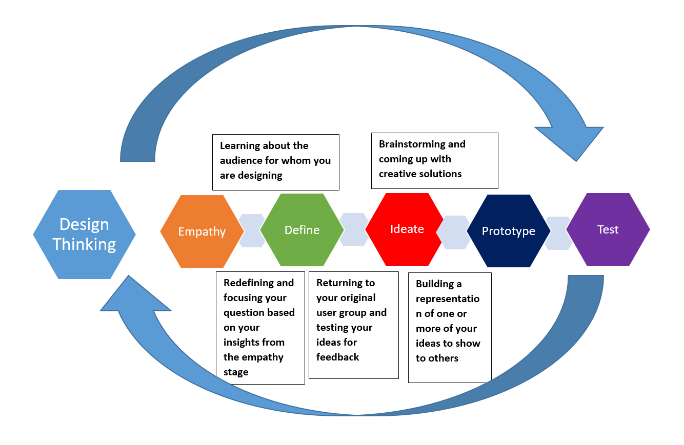
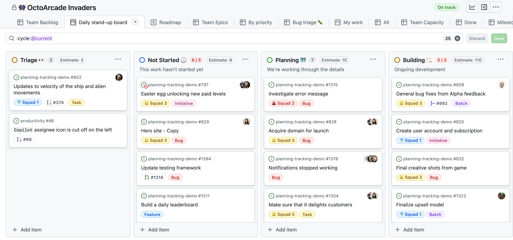
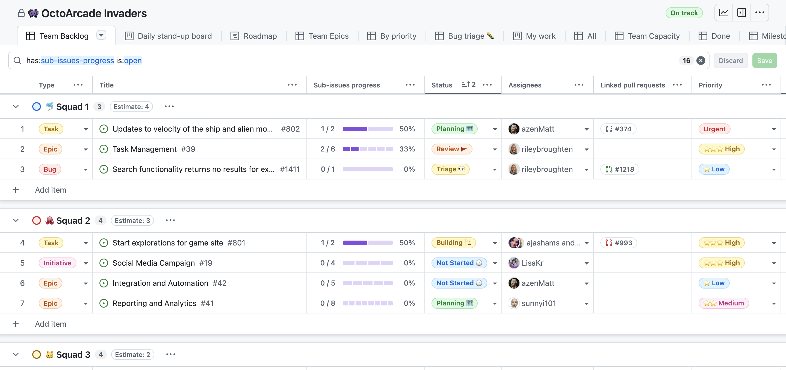

# Stop de ontkoking.
### De laatste pitches — en dan bouwen we de MVP.
*Creative Software Developer — Grafisch Lyceum Rotterdam · BEROEPS2 · week 4*

Note: Welkom bij BEROEPS2, week 4. We zitten op de helft van de periode. Vandaag twee dingen: eerst krijgen de teams die nog niet aan de beurt waren hun elevator pitch, daarna beginnen we met de MVP — de minimale versie van jullie product die het idee al bewijst. Ga direct bij je team zitten, we starten meteen.

---

Leerdoelen

## Aan het einde van deze les kun je …

1. je concept in een korte **elevator pitch** (30–60 seconden) presenteren aan de opdrachtgever;
2. uitleggen waarom een project zonder één beheerd bord onbestuurbaar wordt;
3. een **MVP** opknippen in kleine, zelfstandige taken (issues) op een GitHub Projects-bord;
4. bij andermans pitch een concrete Top en Tip geven.

Note: Benoem de doelen expliciet (Gagné, gebeurtenis 2). Koppel doelen 1 en 4 aan de pitches van vandaag en doelen 2 en 3 aan de MVP-kick-off.

---

Status · Waar staan we?

## Het concept staat — nu moet de MVP het bewijzen

Onderzoek &amp; concept → Elevator pitch → MVP bouwen → Testen met gebruikers

  

    Afgerond
    <h3>Onderzoek &amp; concept</h3>
    
Het idee is onderzocht, gekozen en aangescherpt met <strong>Design Thinking</strong>. De kern van het probleem is helder.

  

  

    Vandaag &amp; hierna
    <h3>MVP bouwen</h3>
    
De pitches afmaken en de <strong>MVP</strong> opknippen in kleine taken in <strong>GitHub Projects</strong>, zodat iedereen weet wat te bouwen.

  

Note: Even de status. We zijn op de helft van de periode. Het onderzoek en het concept staan: jullie weten welk probleem jullie oplossen en waarom. Vandaag maken we de pitches af voor de laatste teams en zetten we de stap naar de MVP. Een MVP is niet het eindproduct — het is de kleinste versie die bewijst dat je idee werkt. Daarvoor hebben we straks een strak projectbord nodig.

---

De aanpak · Design Thinking

## Design Thinking geeft de route: van probleem naar prototype

Je doorloopt vijf stappen — en je mag altijd terug.

<figure>
  
  <figcaption>Design Thinking — vijf stappen, iteratief. Bron: MrJanzen1984 via Wikimedia Commons (CC BY-SA 4.0).</figcaption>
</figure>

Note: Design Thinking is onze routekaart: Empathize (begrijp de gebruiker), Define (formuleer het probleem), Ideate (bedenk oplossingen), Prototype (maak het tastbaar) en Test (toets met gebruikers). Het is geen rechte lijn — je mag altijd terug. Vorige periode hebben jullie dit doorlopen; vandaag oogsten we de opbrengst en gaan we bouwen.

---

Opwarmer · Spot de fouten

## Hoeveel fouten zie jij op dit bord?

Bekijk dit sprintbord met je team en noem zoveel fouten als je kunt — let op de titels, de labels en wie wat doet.

  

    To do (6)
    
dingen · website · website maken · Hele website bouwen · koffie halen · ideeën

  

  

    In progress (5)
    
login (urgent · S) · login fixen (urgent · S) · database + api + design (urgent · Y) · Maak alles af · ?

  

  

    In review (1) · Done (2)
    
design · website live (urgent · S) · presentatie (Y)

  

Note: Werkvorm, ongeveer 3 minuten. Laat elk team naar het bord kijken en fouten opsommen. Vraag: wat valt je op, en wat zou jij anders doen? Inventariseer klassikaal; de antwoorden staan op de volgende slide.

--

### Dit valt op

<ul class="check">
  <li>Dubbele taken: “website” én “website maken”; “login” én “login fixen”.</li>
  <li>Geen echte taken: “koffie halen” en “ideeën”.</li>
  <li>Te grote taken (niet atomic): “Hele website bouwen”, “Maak alles af”, “database + api + design”.</li>
  <li>Geen type-labels (Epic / Task / Bug), dus je ziet de grootte niet.</li>
  <li>Alles is “urgent” — als alles urgent is, is niets urgent.</li>
  <li>Bijna niemand is toegewezen; één persoon (S) doet drie taken: geen eigenaarschap.</li>
  <li>Te veel tegelijk in “In progress” (WIP te hoog), dus niets wordt afgerond.</li>
  <li>Geen acceptatiecriteria en geen datums; “Done” bevat ongecontroleerd werk.</li>
</ul>

Note: Loop de fouten klassikaal langs. Sluit af met de brug naar de volgende slide: precies daarom spreken we één beheerd bord en atomic issues af.

---

Werkwijze · GitHub Projects

## Zonder één beheerd bord wordt je project onbestuurbaar

  

    Het knelpunt
    <h3>Werk leeft in hoofden en chats</h3>
    
Taken leven in iemands hoofd of in losse chatberichten. Niemand ziet wie waaraan werkt — en werk blijft liggen.

  

  

    De afspraak
    <h3>Alles op één bord</h3>
    
Alles wat gebouwd wordt, staat als <strong>issue</strong> op één bord. Wat niet op het bord staat, gebeurt niet.

  

<figure>
  
  <figcaption>GitHub Projects — boardweergave met kolommen en kaarten. Bron: github/docs (CC BY 4.0).</figcaption>
</figure>

Note: Als taken alleen in jullie hoofd of in chatberichten leven, weet niemand wie waaraan werkt en blijft werk liggen — dat noemen we cowboy coding. De afspraak is simpel: alles wat gebouwd wordt, staat als issue op één gedeeld bord in GitHub Projects. Laat de boardweergave zien: elke kaart is één issue met labels en een toegewezen teamlid.

---

Werkwijze · Atomic issues

## Knip de MVP op in issues van maximaal één dag

  
1
<h3>Epic — het grote idee</h3>
Eén module of thema, bijvoorbeeld “Account &amp; favorieten”.

  
2
<h3>User story — wat wil de gebruiker?</h3>
Klein genoeg om te plannen, groot genoeg om nut te hebben.

  
3
<h3>Atomic issue — één heldere taak</h3>
Maximaal één dag werk. Krijg je het niet in een dag af, dan is het te groot: knip het nog eens op.

<figure>
  
  <figcaption>Table-weergave — type, titel en sub-issue-voortgang per item. Bron: github/docs (CC BY 4.0).</figcaption>
</figure>

Note: Een MVP is te groot om in één keer te bouwen, dus knippen we het op. Dat noemen we atomic issues: elk issue is één heldere, afgeronde taak van maximaal één dag werk. De structuur is: eerst een Epic (het grote idee), dan user stories (wat wil de gebruiker?), en die splits je in losse taken. In de tabel zie je per item het type — Epic, Task of Bug — én de sub-issue-voortgang. Regel voor vandaag: als je een taak niet binnen een dag afkrijgt, is hij te groot.

---

Kijkersopdracht · Top / Tip

## Als publiek leer je minstens zoveel als de pitcher

Bij elke pitch noteer je twee dingen: één Top en één Tip.

  

    Top
    <h3>Wat werkte goed?</h3>
    
Noem iets concreets dat je overtuigde — een sterke opening, een helder verhaal, een goed argument.

  

  

    Tip
    <h3>Wat kan beter?</h3>
    
Geef een concrete, opbouwende volgende stap.

  

**Spelregels:** concreet en opbouwend, en over de pitch — niet over de persoon. Schrijf je Top/Tip op; we bespreken ze na.

Note: Terwijl de teams pitchen, ben jij geen passief publiek maar een scherpe kijker. Bij elke pitch schrijf je één Top en één Tip op. Houd het opbouwend en gericht op de pitch, niet op de persoon. Na de ronde bespreken we een paar Top/Tips klassikaal. Slimme zet: leen goede ideeën voor je eigen pitch.

---

Showtime · Elevator pitch

## Wie pakt het podium?

Dertig seconden. Eén kans. Vertel waarom jouw idee ertoe doet — en waarom wij erin moeten investeren.

  Podium!
  
Top/Tip in de aanslag — jij bent nu het publiek.

Note: En nu is het jullie beurt: wie pakt het podium? Je pitch is kort en krachtig — ongeveer een halve tot een hele minuut. Vertel het probleem, je oplossing en waarom die het waard is. De rest van de klas schrijft een Top en een Tip op. Ik houd de tijd in de gaten.

---

Afronding · Onthoud dit

## Van concept naar MVP — in drie stappen

  

    1
    <h3>Pitch je idee</h3>
    
Kort, concreet en overtuigend — aan de opdrachtgever.

  

  

    2
    <h3>Eén beheerd bord</h3>
    
Alles wat je bouwt, staat als issue op GitHub Projects.

  

  

    3
    <h3>Atomic issues</h3>
    
Klein en zelfstandig: maximaal één dag werk per taak.

  

**Vervolgstap:** knip jullie MVP op in issues op het bord en claim je eerste taak. Volgende les start de bouw.
